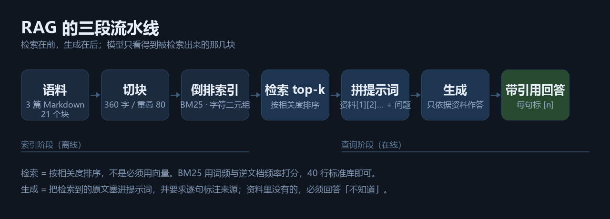
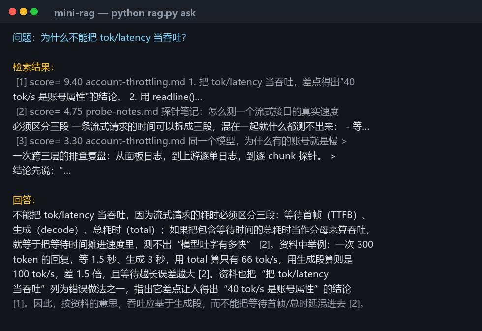

# mini-rag

一个**不依赖任何第三方库**的 RAG（检索增强生成）实现，用来把 RAG 讲清楚。

- 检索：手写 BM25（约 40 行标准库），中文用字符二元组代替分词
- 生成：调任意 OpenAI 兼容端点，强制只依据资料作答并标注引用
- 测试：11 个用例，覆盖切块 / 分词 / 排序 / 提示词 / 端到端
- 规模：`rag.py` 约 230 行，`corpus/` 3 篇文档 → 21 个块



## 为什么不用向量库

因为**检索的本质是按相关度排序**，不是"必须有 embedding"。

BM25 用词频和逆文档频率打分：一个词在本文档里出现得多、在整个语料里少见，就说明它区分度高。这套东西对型号、错误码、专有名词的效果往往比 embedding 更准，而且零依赖、可解释。

embedding 解决的是另一件事：**同义词和换个说法**。工程上常见的是混合检索——两路各取 top-k 再合并。这个 demo 只做第一路，够用，也够讲清楚。

## 跑起来

```bash
python rag.py index                              # 建索引，看切块统计
python rag.py ask "为什么不能把 tok/latency 当吞吐"
python rag.py ask "分块太大会有什么问题" --no-llm   # 只看检索，不调用模型
```

环境变量（可选）：

```bash
RAG_BASE_URL=http://127.0.0.1:7863
RAG_MODEL=deepseek-v4.1-flash
RAG_CONFIG=/path/to/config.json    # 里面要有 api_key
```

## 实际输出



第三个查询是故意的：问一个资料里完全没有的问题，模型应当回答**「资料中没有相关内容」**——这是 RAG 和纯 LLM 唯一硬性的区别。

## 测试

```bash
python -m unittest discover -s tests -v
```

11 个用例，只测真正决定结论的部分（切块边界、中文分词、排序单调性、提示词引用），不测网络。

## 关键设计

| 决策 | 原因 |
|---|---|
| 切块 360 字 / 重叠 80 | 太大会混主题，太小会切断语义；重叠保证被切断的句子至少在下一块完整出现 |
| 中文二元组 | 不装分词器也能区分主题，零依赖 |
| 提示词强制引用 `[n]` | 让"有没有依据"可被人工核对 |
| 明确允许拒答 | 第三条最容易被忽略，也最能区分真假 RAG |
| 不测网络 | 上游抖动会造成假红，测试只钉逻辑 |

## 目录

```
rag.py              # 全部实现
corpus/             # 语料（3 篇）
tests/test_rag.py   # 11 个用例
docs/*.png          # 配图
```
